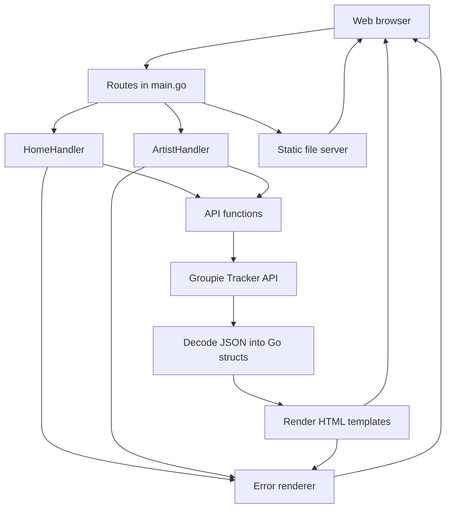
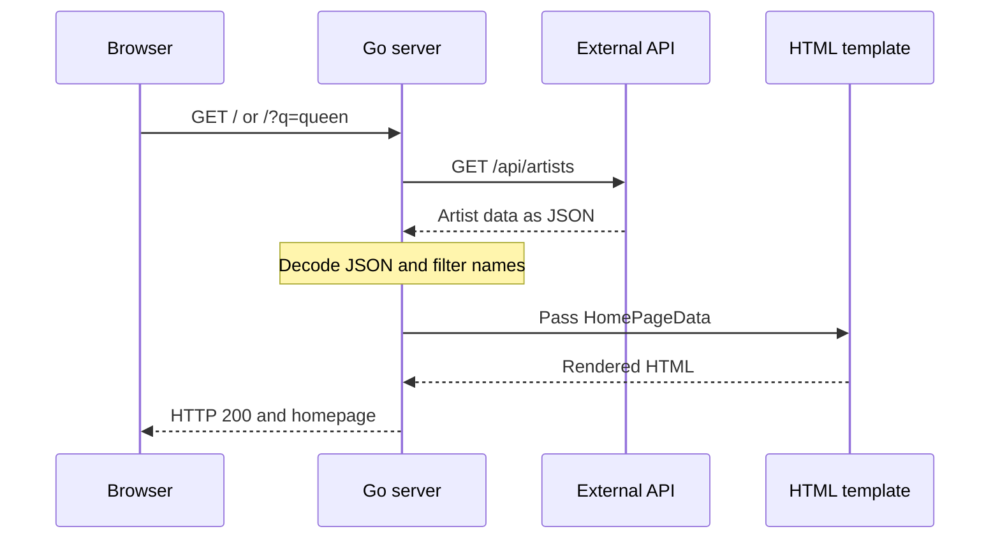
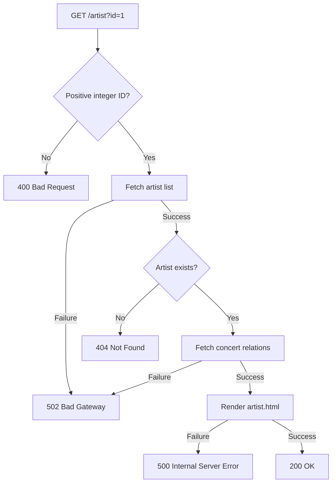

# Groupie Tracker

A Go web application for exploring music artists, band members, and concert locations and dates.

The application retrieves data from the Groupie Tracker API, converts JSON into Go structs, and displays the information using HTML templates.

## Features

- Browse artists in a responsive card layout.
- Search artists by name with case-insensitive matching.
- View individual artist profiles.
- View band members, starting year, and first album date.
- Explore concert locations and their associated dates.
- Display custom error pages for invalid requests and server failures.
- Blur the image of artist ID 21 on both the homepage and details page.

## Technology Stack

| Technology | Purpose |
|---|---|
| Go | HTTP server, routing, API requests, and application logic |
| Go standard library | All backend functionality; no external Go packages |
| HTML templates | Server-rendered pages |
| CSS | Styling, responsive layouts, and image blur |
| JSON | Data format received from the external API |

No database or frontend JavaScript is required.

## Project Structure

```text
groupie-tracker/
├── main.go
├── go.mod
├── README.md
├── tracker/
│   ├── api.go
│   ├── handlers.go
│   └── models.go
├── templates/
│   ├── index.html
│   ├── artist.html
│   └── error.html
└── static/
    └── style.css
```

| File | Responsibility |
|---|---|
| `main.go` | Registers routes and starts the HTTP server |
| `tracker/api.go` | Sends API requests and decodes JSON responses |
| `tracker/handlers.go` | Handles requests, searches artists, and renders pages |
| `tracker/models.go` | Defines API data structures and template data structures |
| `templates/index.html` | Displays artist cards and the search form |
| `templates/artist.html` | Displays an artist’s profile, members, and concerts |
| `templates/error.html` | Displays the HTTP status, error title, and message |
| `static/style.css` | Defines the visual design and responsive behavior |

## Requirements

- Go compatible with the version declared in `go.mod`.
- Internet access to retrieve API data and artist images.
- A web browser.
- Port `8080` available.

The current `go.mod` declares Go `1.27.1`.

## Running the Application

Open a terminal in the project’s root directory:

```bash
cd groupie-tracker
go run .
```

Open:

```text
http://localhost:8080
```

Keep the terminal running while using the website.

To stop the server, press:

```text
Ctrl+C
```

Run the application from the project root because template and static-file paths are relative to that directory.

## Application Architecture

The Go server handles browser requests, retrieves external data, and produces HTML responses.



The browser also downloads artist images directly from the image URLs provided by the API.

## Understanding the API

An API allows one application to request information from another service.

This project uses:

```text
https://groupietrackers.herokuapp.com/api
```

The API exposes four main resources:

| Resource | Information |
|---|---|
| `artists` | Artist names, images, members, starting years, and first album dates |
| `locations` | Concert locations |
| `dates` | Concert dates |
| `relation` | Associations between artists, locations, and dates |

### Endpoints Used by This Application

| Endpoint | Purpose |
|---|---|
| `/api/artists` | Retrieve the artist list |
| `/api/relation/{id}` | Retrieve locations and their associated dates for one artist |

The application uses the relation endpoint for paired concert information. It does not request the standalone locations and dates endpoints separately.

### API Request Handling

Both API functions use a shared HTTP client with a ten-second timeout.

For each request, the application:

1. Sends an HTTP GET request.
2. Checks for connection or timeout errors.
3. Checks that the response status is `200 OK`.
4. Decodes the JSON body into a Go struct or slice.
5. Closes the response body.
6. Returns the decoded data or an error.

## Request Flow

### Homepage and Search



Search is performed on the Go server:

- Leading and trailing spaces are removed.
- The query and artist names are converted to lowercase for comparison.
- Partial name matches are included.
- An empty query displays all artists.
- The displayed count represents the number of matching artists.

Search currently supports artist names only.

### Artist Details

When someone selects **View details**, the browser requests a URL such as:

```text
/artist?id=1
```

The server then:

1. Checks that the request uses GET.
2. Reads and validates the artist ID.
3. Fetches the artist list.
4. Finds the artist with that ID.
5. Fetches the artist’s concert relation data.
6. Combines both results into `ArtistPageData`.
7. Renders `artist.html`.



This interaction demonstrates the project’s client-server requirement: a user action triggers a request, the server processes it, and the browser receives a response.

## Routes

| Method | Route | Behavior |
|---|---|---|
| GET | `/` | Display all artists |
| GET | `/?q=queen` | Display artists matching the search query |
| GET | `/artist?id=1` | Display one artist and their concerts |
| GET | `/static/style.css` | Serve the stylesheet |

Unsupported methods on `/` and `/artist` return `405 Method Not Allowed`.

Unknown page paths return `404 Not Found`.

## Data Models

### Artist

Stores information received from the artists endpoint:

- `ID`
- `Image`
- `Name`
- `Members`
- `CreationDate`
- `FirstAlbum`

JSON tags connect API field names to Go struct fields.

For example:

```go
Name string `json:"name"`
```

### Relation

Stores the artist ID and concert associations:

```go
DatesLocations map[string][]string
```

Each map key represents a location. Its value is a list of dates associated with that location.

### Template Data

| Struct | Contents |
|---|---|
| `HomePageData` | Artist list, search query, and matching count |
| `ArtistPageData` | Selected artist and concert information |
| `ErrorPageData` | HTTP status code, title, and message |

## Template Rendering

The application uses Go’s `html/template` package.

Templates are rendered into a `bytes.Buffer` before being sent to the browser. This allows rendering failures to produce a clean error response instead of sending an incomplete page.

`html/template` also applies contextual escaping to inserted data.

### Homepage Example

The homepage receives `HomePageData`, so it loops through `.Artists`:

```html
{{range .Artists}}
    <h3>{{.Name}}</h3>
{{end}}
```

Inside the loop, the dot represents the current artist.

### Details Page Example

The details page receives `ArtistPageData`:

```html
<h1>{{.Artist.Name}}</h1>
```

Concert information is displayed using nested loops: one for locations and one for each location’s dates.

## Error Handling

| Status | Meaning in This Application |
|---|---|
| 400 | Missing, non-numeric, or non-positive artist ID |
| 404 | Unknown page or artist ID that does not exist |
| 405 | Unsupported HTTP method |
| 500 | Failed to load or execute a page template |
| 502 | Failed to fetch or decode external API data |

Error pages use `templates/error.html` and preserve the correct HTTP status code.

For rejected methods, the server also sends:

```text
Allow: GET
```

If the error template itself cannot be loaded or rendered, the application falls back to a plain-text HTTP error.

Errors from the static file server use its built-in responses.

## Manual Testing

Start the server before running these checks.

### Normal Behavior

| Test | Expected Result |
|---|---|
| Open `/` | Artist cards appear |
| Search `queen` | Matching artists appear |
| Search `QUEEN` | Same matches as lowercase |
| Submit an empty search | All artists appear |
| Search an unmatched name | No-results message appears |
| Select View details | Artist information and concerts appear |
| Resize the browser | Layout adapts to smaller screens |
| View artist ID 21 | Image is blurred on both pages |

### Check HTTP Status Codes

Run these commands in a second terminal:

```bash
# Unknown page: 404
curl -i http://localhost:8080/hello

# Invalid artist ID: 400
curl -i "http://localhost:8080/artist?id=abc"

# Unsupported method: 405
curl -i -X POST http://localhost:8080/

# Unknown artist: 404 when the API is available
curl -i "http://localhost:8080/artist?id=99999"
```

### Demonstrate a 500 Error

With internet access working, temporarily rename the homepage template:

```bash
mv templates/index.html templates/index.html.bak
```

Refresh the homepage. The application should display a 500 error.

Restore the template immediately afterward:

```bash
mv templates/index.html.bak templates/index.html
```

### Demonstrate a 502 Error

Keep the local Go server running, disconnect internet access, and refresh the homepage.

The API request will fail, and the application should display a 502 error. A timeout may take approximately ten seconds.

Reconnect after the test.

These are manual test procedures. The project currently does not include automated test files.

## Design

The interface includes:

- A dark background with green accents.
- A responsive artist card grid.
- Separate artist profile and concert panels.
- Keyboard focus indicators.
- Lazy-loaded homepage images.
- Reduced-motion support.
- A custom error-page layout.

Artist ID 21 receives a conditional CSS class:

```css
.blurred-image {
    filter: blur(18px);
}
```

This changes the visual presentation only. The original image still downloads to the browser.

## Current Limitations

- Internet access is required for external data and images.
- API responses are fetched on each relevant page request; there is no application cache.
- Search only matches artist names.
- The details handler retrieves the full artist list before selecting one artist.
- Concert location labels and dates are displayed as received from the API.
- Automated tests have not been added.

## Learning Outcomes

This project demonstrates:

- Client-server request and response handling.
- Consuming an external HTTP API.
- Decoding JSON into typed Go structures.
- Working with slices and maps.
- Rendering dynamic HTML templates.
- Organizing code into a Go package.
- Validating input and handling errors.
- Building responsive interfaces with HTML and CSS.